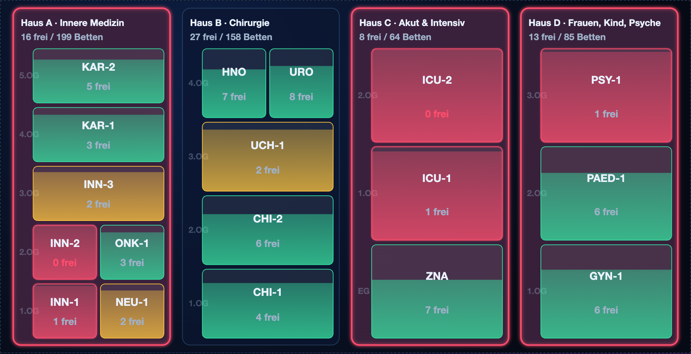
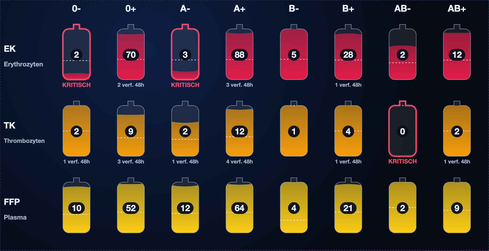
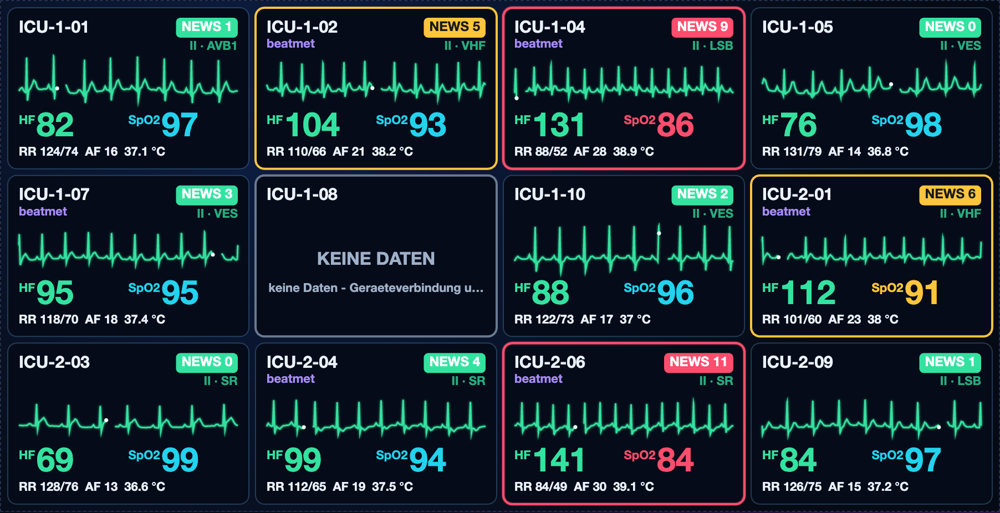
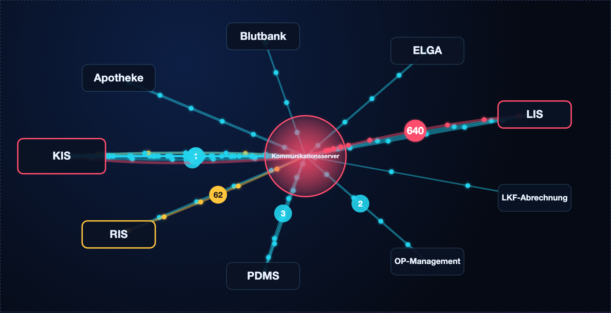

# KIS Klinik (kis_klinik)

Dashboard-Studio-App fuer das **Splunk Allgemeine Krankenhaus (SAKH)**: 15 Dashboards in hellem,
klinischem Design (weisser Kopfbereich, flache Reiter, weisse Karten, Krankenhaus-Blau und Petrol) mit Navigation, Abteilungs- und Hausfiltern, Drilldowns und elf
interaktiven Canvas-Visualisierungen. Liest ausschliesslich, was `TA-kis-datagen` schreibt:
Events aus `demo_sakh`, Zeitreihen per `mstats` aus `demo_sakh_metrics`.

## Installation

1. `TA-kis-datagen` installieren und den Input starten (siehe dessen README).
2. `kis_klinik-1.0.6.spl` installieren (*Apps → Manage Apps → Install app from file*,
   Splunk Cloud: ACS). Benoetigt Splunk Enterprise oder Splunk Cloud Platform 10.4 oder neuer
   (Dashboard-Studio-Erweiterungen).
3. *KIS Klinik (SAKH)* oeffnen – Start ist die *Klinik-Uebersicht*.

Die Visualisierungen werden global exportiert und stehen auch in anderen Apps zur Verfuegung
(Kategorie *SAKH* in der Visualisierungsauswahl).

## Seiten

| Bereich | Seiten | Filter | Interaktion |
| --- | --- | --- | --- |
| Klinik-Uebersicht | Lagebild | Zeit | Station im Lageplan oeffnet das Bettenmanagement der Abteilung |
| Patientenversorgung | Betten, Notaufnahme, OP, Intensiv | Zeit, Abteilung, Haus | Lageplan filtert nach Abteilung, Triage-Stufe filtert Zugaenge, Saal zeigt seine Faelle, Bett zeigt seinen Verlauf |
| Diagnostik & Versorgung | Labor & Radiologie, Blutdepot, Apotheke & Pflege | Zeit, Abteilung | Blutbeutel filtert Verlauf und Transfusionen |
| Medizintechnik | Medizintechnik | Zeit, Abteilung, Haus | Grossgeraet zeigt Schild- und Kuehlwassertemperatur |
| Netzwerk | Catalyst & ISE, Cisco IQ | Zeit, Haus | Health-Ring filtert das Haus, Switch-Zeile filtert das Syslog, Advisory zeigt betroffene Geraete |
| IT-Betrieb | Server & Datenbanken, HL7 & eHealth, CMDB & ITSM | Zeit, Haus | Server-, Kanal- und CI-Auswahl per Klick |
| Sicherheit | Sicherheit | Zeit, Abteilung | – |

Metrik-Panels (`mstats` auf `demo_sakh_metrics`): Bettenbelegung, Notaufnahme-Board, Blut-Fuellstand,
Intensiv-Vitalwerte, Pflegeschluessel, Medizintechnik (online, Alarme, Helium, Kuehlung),
Catalyst Health, ThousandEyes, Server, Datenbanken, VMware, HL7-Kanaele und eHealth-Antwortzeiten.
Alles mit Status-Texten (Tabellen, Lageplan, Blutdepot, Intensiv-Monitorwand, OP-Plan, Cisco IQ, CMDB)
kommt aus den Events in `demo_sakh`.

## Visualisierungen

| Visualisierung | Zeigt | Datenvertrag |
| --- | --- | --- |
| Klinik-Lageplan (`hospital_map`) | Haeuser, Etagen und Stationen mit Belegung und freien Betten | [SPL.md](visualizations/hospital_map/SPL.md) |
| Blutdepot (`blood_bank`) | Blutbeutel je Produkt und Blutgruppe mit Fuellstand und Mindestbestand | [SPL.md](visualizations/blood_bank/SPL.md) |
| Notaufnahme-Fluss (`ed_flow`) | Wartende je Manchester-Triage-Stufe, laengste Wartezeit gegen das Ziel | [SPL.md](visualizations/ed_flow/SPL.md) |
| OP-Saalplan (`or_timeline`) | Gantt je Saal: geplant, tatsaechlich, verspaetet, abgesetzt | [SPL.md](visualizations/or_timeline/SPL.md) |
| Intensiv-Monitorwand (`icu_wall`) | Monitor-Kacheln je Bett mit EKG-Kurve, HF, SpO2, RR, NEWS2 | [SPL.md](visualizations/icu_wall/SPL.md) |
| Schnittstellen-Fluss (`hl7_flow`) | Kommunikationsserver mit Nachrichtenfluss und Warteschlangen je Kanal | [SPL.md](visualizations/hl7_flow/SPL.md) |
| Bildgebung (`imaging_status`) | MRT mit Heliumtank und Kaltkopf, CT mit Roehrenlast | [SPL.md](visualizations/imaging_status/SPL.md) |
| Service-Abhaengigkeiten (`dependency_graph`) | CMDB-Ebenen vom Business Service bis zum Switch, Impact nach oben | [SPL.md](visualizations/dependency_graph/SPL.md) |
| Health Rings (`health_rings`) | KPI-Ringe mit Schwellwerten | [SPL.md](visualizations/health_rings/SPL.md) |
| Heat Timeline (`heat_timeline`) | Heatmap je Serie ueber die Zeit | [SPL.md](visualizations/heat_timeline/SPL.md) |






Alle Visualisierungen unterstuetzen HiDPI, helles und dunkles Theme, Tastaturbedienung,
Tooltips, `prefers-reduced-motion` und Drilldowns mit flachem `{name, value}`-Payload.

## Hinweise

- `default/props.conf` (nicht exportiert) extrahiert die JSON-Felder der Vendor-Sourcetypes
  (`cisco:dnac:*`, `cisco:iq:*`, `snow:*`) nur innerhalb dieser App. Verarbeitet ein Cisco-Catalyst-
  oder ServiceNow-Add-on mit `INDEXED_EXTRACTIONS` dieselben Sourcetypes auf den Indexern, dort in
  `local/props.conf` `KV_MODE = none` setzen.
- `cisco:ios`, `cisco:ise:syslog`, `WinEventLog` und `syslog` werden in den Suchen per `rex`
  zerlegt und sind damit unabhaengig von installierten Add-ons.

## Entwicklung

```bash
npm ci
npm run dashboards                  # Dashboards, Hintergrund-SVGs und Navigation aus dashboards/pages/*.mjs
npm run build:prod                  # Visualisierungen bauen
npm run check                       # Harness in Chrome (Leer-/Fehlerdaten, Resize, Theme, Optionen, Drilldown, Tastatur, Reduced Motion)
npm run check:esm                   # Bundles sind eigenstaendige ES-Module ohne Imports
npm run package                     # dist/kis_klinik-<version>-<hash>.spl
```

- `dashboards/lib/studio.mjs`: Raster, Farben, Bereiche, Filter, Visualisierungs-Helfer, Seitenaufbau.
- `dashboards/lib/svg.mjs`: Hintergrundgrafik, Panel-Rahmen und Navigationsbuttons.
- `dashboards/lib/spl.mjs`: gemeinsame SPL-Bausteine (Indexe, `rex` fuer IOS und ISE, Ring-Zeilen).
- `dashboards/pages/*.mjs`: eine Datei je Dashboard.
- `node dashboards/generate.mjs --queries <seite>` gibt alle Suchen einer Seite mit Standard-Tokens aus.

Die generierten Dateien unter `package/app/default/data/ui/views/` und
`package/app/appserver/static/images/` sind eingecheckt; geaendert werden die Seiten-Dateien,
nicht das generierte XML.
